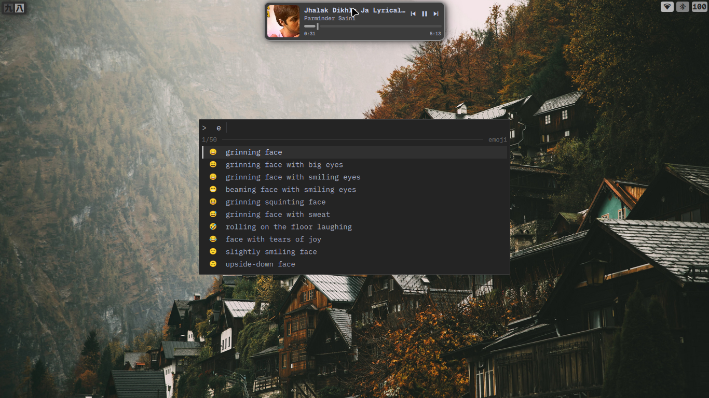
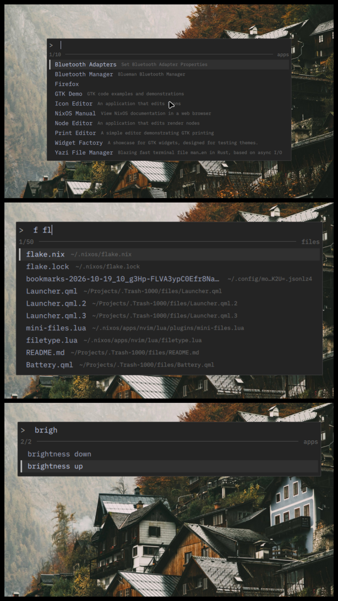
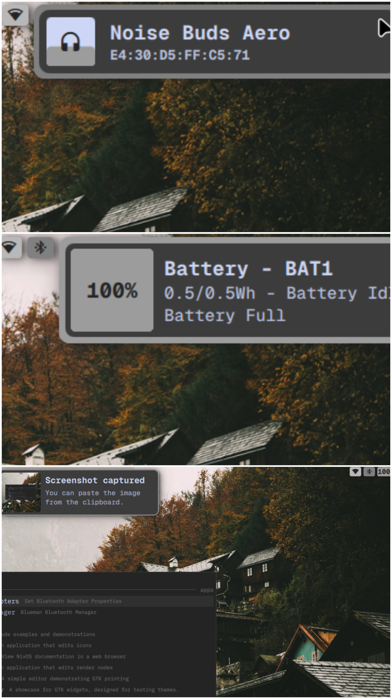

# Minimal Quickshell for Niri

A minimal, fast, fully functional Quickshell setup for **niri**.

Forked from [voidarc/quickshell](https://git.voidarc.co.uk/voidarc/quickshell/), which targets Hyprland only. This fork adapts the bar and the rest of the config to work with niri.

> Using Hyprland? Use the original repo instead. This one is niri-only.

## Bar

- **Time pill**: shows the time(ofc), and pops up as a toast area for notifications, screenshots and device connections message.
  - **Media toast**: hover the pill while music or video is playing (MPRIS toast) to see what's on. Skip to next/previous and drag the timeline to seek. *Still in development.*
- **Wi-Fi, Bluetooth, battery**: only shows what it is supposed to. Click one to open a detail widget.

## Launcher

No bloated icons, no over-the-top animations. Just a quick launcher that does everything you need.

| Mode | Trigger | Keybind |
|------|---------|---------|
| Apps | type anything (default) | `Mod + Space` |
| Files | prefix with `f<Space>` (searches `$HOME`, opens in default app) | `Mod + Alt + Space` |
| Emoji | prefix with `e<space>` | `Mod + .` |
| Clipboard history | prefix with `c<space>` | `Mod + Shift + V` |
| System actions | reboot, shutdown, etc. | why do u even need it |

Every mode can also be opened directly with its keybind.

## Thoughts

There are lots of quickshell rices, launcher on the internet you can think of. But most of them looks cool but are bloat, over-animated, mid or in brief, shit. This qs config is very cool, minimal yet funtional. The launcher is the best thing is this config as i made it :)(ignore color palette, wanted to made it monochrome, i am bad with it). 
